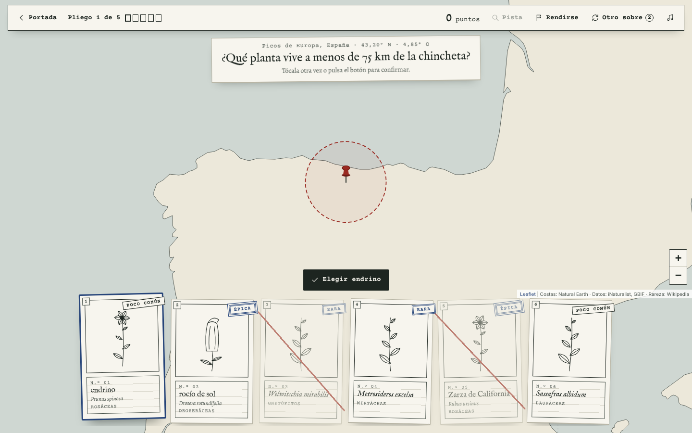
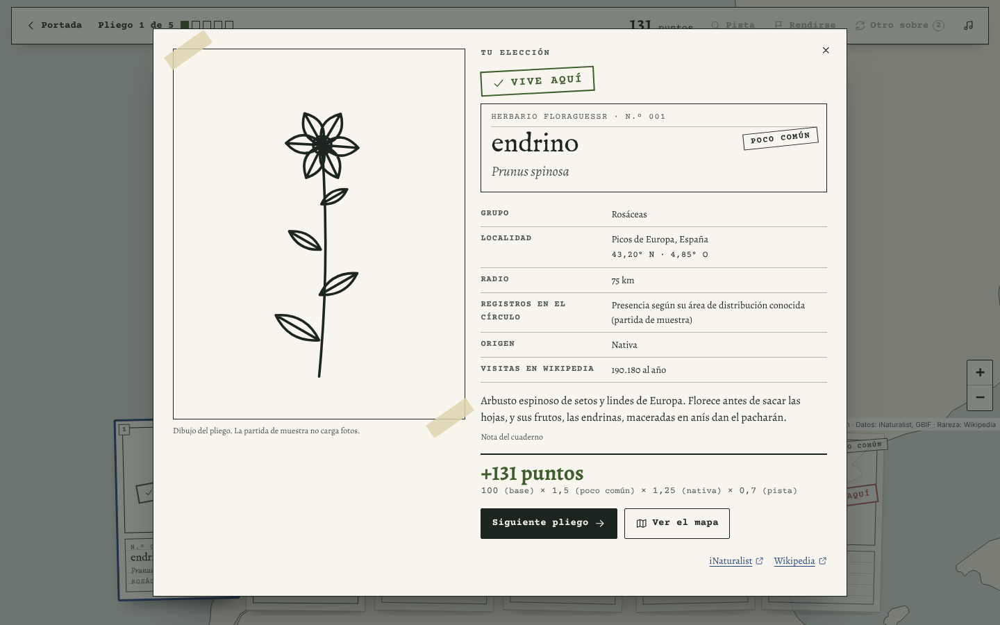
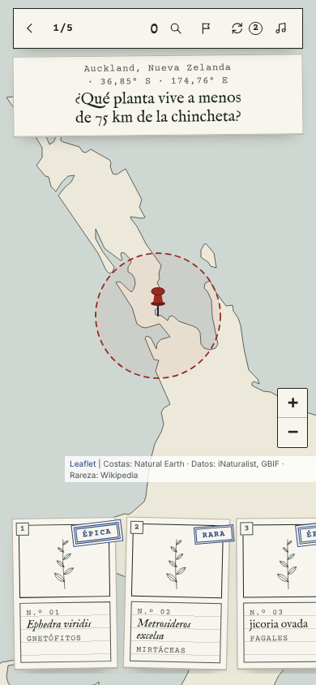
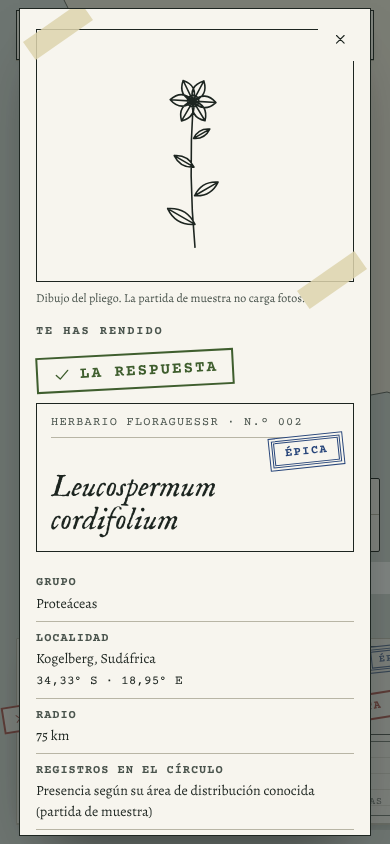
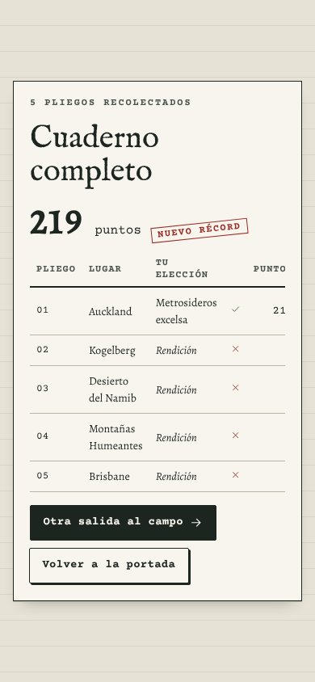

# FloraGuessr

Juego de botánica en el navegador. Te deja en un punto real del mapa y, entre seis fichas de herbario,
tienes que elegir una planta que viva a menos de 75 km. Cuanto menos visitado está el artículo de la
planta en Wikipedia, más rara es y más puntos vale. La presencia se comprueba con iNaturalist y GBIF.
La música es generativa y cambia de escala según el continente.

| Portada | Ronda | Ficha |
|---|---|---|
|  |  |  |
|  |  |  |

## Arranque

```bash
npm install
npm run dev            # http://localhost:5173 — versión completa (necesita red)
npm run dev -- --open "/?muestra"   # partida de muestra sin red
npm test               # tests unitarios (Vitest)
npm run test:e2e       # extremo a extremo (Playwright, APIs simuladas)
npm run build          # dist/ — versión completa
npm run build:demo     # dist-demo/ — partida de muestra + fragmento para publicarla como Artifact
npm run species        # regenera public/data/equilibrado.json desde legacy/especies.js
npm run verify-apis    # comprueba con llamadas reales los parámetros de iNaturalist
```

Variables (opcional, ver `.env.example`): `VITE_ESRI_KEY`, clave de ArcGIS Location Platform para el satélite.

## Modos

- **Mundial**: sin listas. Sale una observación real de planta en una región al azar. Las fichas válidas
  salen del recuento de especies en 75 km (preferimos nativas); los señuelos, de la región amplia
  (500–2.500 km según dificultad) y se confirma con una sola llamada que no tienen registros en el círculo.
- **Equilibrado**: base cerrada (`public/data/equilibrado.json`, 1.217 especies en 35 grupos). Cada sobre
  lleva un grupo distinto por ficha y el lugar es un registro fiable de GBIF de una de ellas.
- **Partida de muestra** (`?muestra` o `build:demo`): siete lugares preparados con especies reales de la
  base, sin red. Es lo que se publica como vista previa, porque el visor de Artifacts no permite llamar a
  APIs externas ni cargar teselas o fotos de otros dominios. No enseña recuentos (no los ha consultado).

## Arquitectura

```
src/
  config.ts        reglas (radio, rondas, puntuación) y límites de red por servicio
  api/             red: http.ts (cola + reintentos), queue.ts (cubo de fichas), cache.ts (IndexedDB),
                   inat.ts, gbif.ts, wikipedia.ts, groups.ts (ancestros → grupo y silueta)
  game/            lógica pura: machine.ts (estados), scoring.ts, rarity.ts, geo.ts (WKT, continente),
                   pack.ts (montaje del sobre), sources.ts (rondas Mundial/Equilibrado + precarga),
                   demo.ts, iucn.ts, random.ts
  audio/           scales.ts (escala por continente, puro), engine.ts (Web Audio)
  ui/              app.ts (controlador), cards.ts, map.ts (Leaflet), icons.ts, specimen.ts, fern.ts
  i18n/es.ts       todos los textos (en.ts en la fase 5)
  styles/          tokens.css (paleta y tipos), app.css
scripts/           build-species, build-demo, artifact-page, verify-apis
legacy/            prototipo original, generador y base sin tocar (referencia)
tests/unit         Vitest · tests/e2e  Playwright
```

**Flujo de una ronda.** `RoundPipeline` pide la ronda a la fuente (`ZonalSource`, `BalancedSource` o
`DemoSource`). En cuanto se juega una ronda, ya está preparando la siguiente. Toda la comprobación
(iNaturalist + GBIF) se hace al montar el sobre, así que revelar es instantáneo. Volver a la portada
cancela todo con un `AbortController`.

**Coste por ronda en modo Mundial**: ~6 llamadas a iNaturalist (punto, recuento local, nativas, región,
verificación de señuelos, detalle de taxones), 6+1 a GBIF y 6 de visitas a Wikimedia, más el resumen de
la ficha que se abre. El prototipo hacía ~12 llamadas a iNaturalist solo al revelar.

## Decisiones

- **Sin `order_by=random`.** No está documentado en `/v1/observations`. Elegimos un id al azar y pedimos
  la primera observación por encima (`id_above` + `order_by=id`), dentro de una región al azar entre doce,
  para que no salga siempre Norteamérica o Europa. `npm run verify-apis` lo comprueba en vivo.
- **Cola por servicio**: iNaturalist a 30/min con ráfaga de 5 (piden ≤60/min y ≤10.000/día), GBIF 120/min,
  Wikimedia 150/min. Un 429 pausa la cola del servicio el tiempo de `Retry-After`; los 5xx y fallos de red
  se reintentan con espera exponencial y algo de azar.
- **Caché persistente** en IndexedDB con caducidad por tipo (taxones y visitas 30 días, consultas de zona
  1 día) y deduplicación de peticiones simultáneas. Si no hay IndexedDB, queda en memoria.
- **Wikimedia**: cabecera `Api-User-Agent: FloraGuessr/…` (el navegador no deja fijar `User-Agent`).
- **Sin proxy (Cloudflare Worker), de momento.** iNaturalist limita por IP: un proxy concentraría a todos
  los jugadores en pocas IP y provocaría más 429. Las consultas de zona casi nunca se repiten, así que una
  caché compartida ayudaría poco; lo que sí se repite (taxones, visitas) ya está en IndexedDB y en la base
  precalculada. Se reconsidera si hay tráfico real o si iNaturalist pide centralizar.
- **Teselas**: el endpoint `server.arcgisonline.com` sin clave es heredado y las condiciones de Esri se
  aplican igualmente a apps Leaflet. Con `VITE_ESRI_KEY` usamos el servicio de teselas estáticas de ArcGIS
  Location Platform (capa gratuita; confirmar el límite vigente en la consola). Debajo siempre hay un mapa
  propio dibujado con costas de Natural Earth (dominio público), que es el que se ve sin satélite.
- **Fotos**: solo se muestran si tienen licencia abierta conocida; las de «todos los derechos reservados»
  se descartan y la ficha dibuja una silueta de pliego. La atribución de iNaturalist aparece bajo la foto.
- **Rareza por percentiles.** Con los umbrales fijos del prototipo (300k/100k/40k/15k visitas/año) el 93 %
  de la base salía Legendaria. Ahora el build calcula los cortes para que haya 50/25/15/7/3 % de
  común/poco común/rara/épica/legendaria. En modo Mundial (especies mucho más visitadas) se mantienen los
  umbrales fijos hasta calibrarlos con datos reales.
- **Presencia**: vale con 1 observación de grado investigación en iNaturalist o 2 registros fiables en
  GBIF. El prototipo usaba 3 al revelar pero elegía las válidas con 1, así que una «válida» podía darse
  por fallo.
- **Pista**: tacha dos fichas que no viven allí (la ronda vale ×0,7). Antes listaba artículos de Wikipedia
  cercanos, que daban nombres de pueblos, no de plantas.

## Calidad de la base heredada (`legacy/especies.js`)

`scripts/build-species.mjs` corrige lo que puede sin red:

- 17 especies cuyo artículo de Wikipedia es de otra especie del mismo género (p. ej. *Pinus yecorensis* →
  `Pinus_pseudostrobus`): se descartan sus visitas.
- Estados UICN mezclados con rangos de NatureServe (`G3`, `G2G3`…) y textos en español: se normalizan o
  se descartan.
- Lo que necesita regenerar con red: licencia y autoría de las fotos (la base no las guardó; en juego se
  completan con `/v1/taxa`), nombre común en inglés de reserva (el 82 % no tiene nombre en español), clave
  de GBIF y nº de registros para excluir especies casi sin datos (255 tienen < 30 observaciones), y
  visitas anómalas (p. ej. *Ranunculus insignis*: 173.737 visitas con 669 observaciones).

## Créditos

Observaciones y fotos: iNaturalist y su comunidad (cada foto con su licencia). Registros: GBIF.org.
Rareza y descripciones: Wikipedia (CC BY-SA 4.0). Mapa: Leaflet, Natural Earth, Esri y proveedores.
Tipografías OFL: IM Fell English, Alegreya, Courier Prime (autoalojadas con Fontsource).

## Estado por fases

1. ✅ Esqueleto Vite + TS, red con caché, cola y reintentos, tests.
2. ✅ Núcleo del juego (ambos modos, precarga, validación en una consulta) — falta verificar en vivo.
3. 🟡 Sistema visual de cuaderno de campo: primera versión completa, pendiente de tu aprobación.
4. 🟡 Audio portado del prototipo a módulo; sin cambios de sonido todavía.
5. ⬜ Pulido: PWA, inglés, auditoría de accesibilidad y rendimiento.
